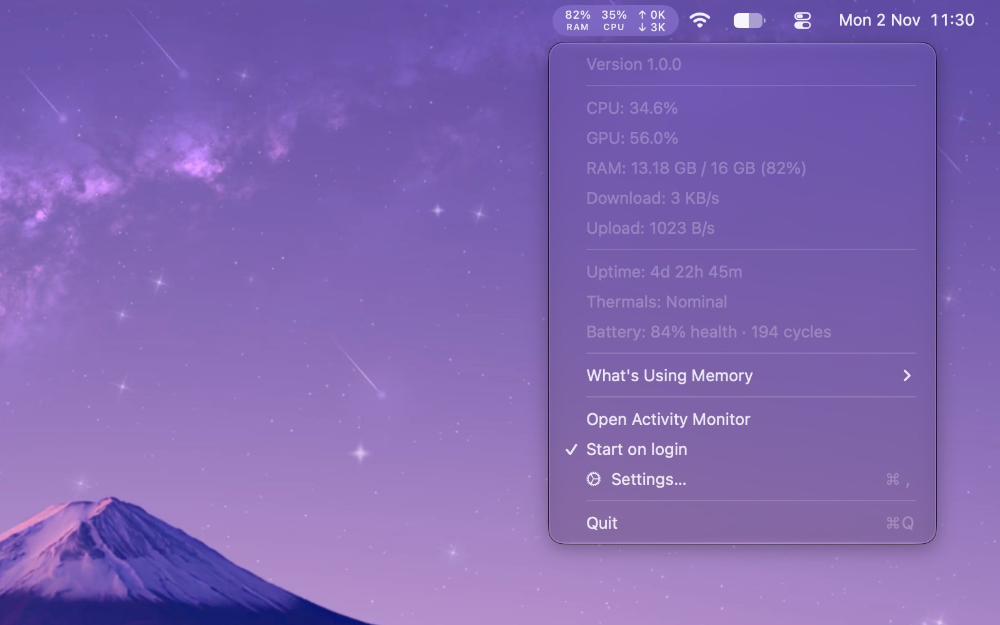
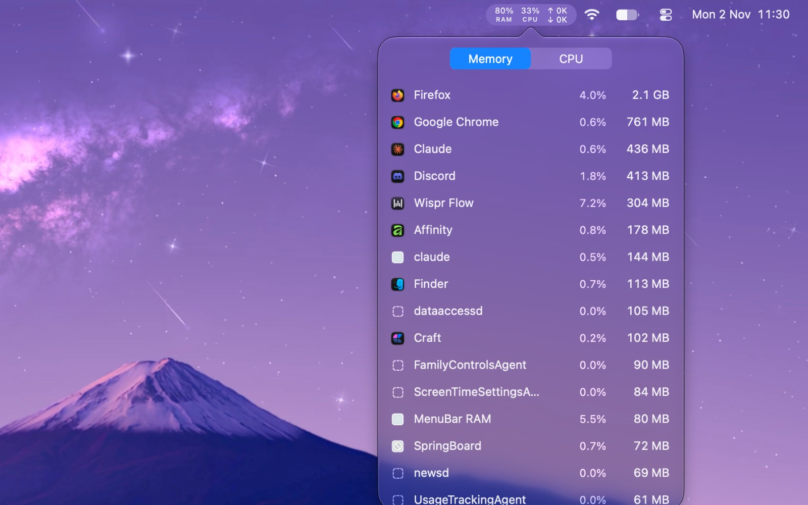

# MenuBar RAM

A tiny native macOS menu bar app that shows memory, CPU, GPU, network and battery health at a glance, and lets you quit whatever is eating your RAM.

<p align="center">
  
  
</p>

## Install

**Homebrew**

```bash
brew tap purpiedragon/tap && brew trust purpiedragon/tap && brew install --cask menubar-ram
```

**Download**

Get the latest **MenuBar-RAM.dmg** from [Releases](../../releases/latest), open it, and drag **MenuBar RAM** to Applications.

Requires macOS 13 or later. The app is signed and notarized by Apple.

## Features

- Customizable menu bar
- Live system stats
- Uptime and thermal state
- Battery health
- Apps and processes
- Start on login

## Uninstall

```bash
brew uninstall --cask --zap menubar-ram
```

Or quit the app, delete it from Applications, and remove `~/.config/menubar-ram`.

---

Copyright © 2026 PurpIeDragon. All rights reserved. This repository hosts release builds only.
